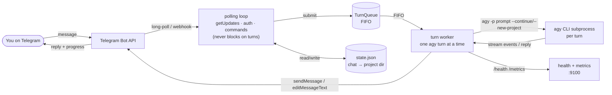

# Telegrav

[](https://github.com/RosyidAl/Telegrav/actions/workflows/ci-cd.yml)
[](https://www.python.org/downloads/)
[](./tests)
[](./LICENSE)

Telegrav is a Telegram bridge daemon for the [Google Antigravity CLI](https://antigravity.google) (`agy`). It runs `agy` as a headless subprocess per turn and reports results back to Telegram. Version: 0.2.0.

- Self-hosted on Linux under `systemd --user`; no display required.
- Each Telegram chat gets its own `agy` project directory (`--new-project` / `--continue`), so sessions persist and stay isolated.
- Forked from [`hah23255/agy-to-im`](https://github.com/hah23255/agy-to-im) (itself bootstrapped from `kimi-to-im`); see [Changes in this fork](#changes-in-this-fork).

## Changes in this fork

- **Non-blocking turn execution** — the polling loop dispatches to a single turn worker, so `getUpdates` keeps running while `agy` works. Messages sent during an active turn are acknowledged immediately (`Queued (position #N)`) and processed in order.
- **Live turn monitor** — the status message is edited in place (throttled) with the agent's tool activity, then finalized as a summary.
- **Per-chat power state** — `/on` / `/off`; after a restart every chat starts inactive and wakes on `/start`.
- **Effort handling aligned with the live `agy` CLI** — effort is expressed through model IDs (suffix composition for Gemini bases); the `--effort` flag is only sent to models that accept it.
- **Media pipeline** — album/burst grouping, follow-up fetch for media bursts, status placeholder before downloads, stray-placeholder cleanup.
- **Message formatting** — Markdown to Telegram HTML with a plain-text fallback on parse errors.
- **Optional OKF memory layer** — per-chat memory vault compiled via graphify in the background.
- **CI/CD** — GitHub Actions (Python 3.11/3.12) with automatic deployment to a VPS on merge to `main`.

## Features

- Telegram ↔ `agy` messaging with an inline control panel (`/settings`, `/model`, `/mode`)
- Photo and document upload with configurable routing (`pass` / `warn` / `hold` / `block` per category)
- Per-user sliding-window rate limiting and a bounded FIFO turn queue with position feedback
- Token usage tracking per chat (`/usage`: last turn, today, lifetime) from `agy`'s stream-json events
- Health endpoint and Prometheus metrics
- Webhook mode with HMAC-SHA256 verification
- Memory gate: the daemon self-terminates above the configured limit and lets systemd restart it
- Zombie subprocess reaping and garbage collection
- `systemd --user` service with hardening; opt-in autostart (`install.sh --autostart`)
- Plugin tool for `agy` (`bridge start/stop/status/logs/setup`)
- 238 tests, green on Linux CI

## Commands

| Command | Description |
|---|---|
| `/start` | Activate the bot (required after a restart; chats start inactive) |
| `/ping` | Latency and health check |
| `/help` | Command overview |
| `/status`, `/info` | Session summary |
| `/settings` | Inline control panel (model, mode, reset) |
| `/model` | Select or view the model override |
| `/mode` | Switch between Code and Plan mode |
| `/effort` | Set reasoning effort (low / medium / high / max) |
| `/cd` / `/pwd` | Change / show the working directory for this chat |
| `/on` / `/off` | Activate / deactivate the bot for this chat |
| `/stop` | Abort the active `agy` turn |
| `/reset` | Start a fresh `agy` project for this chat |
| `/files` | List inbox files (`/files clean` purges them) |
| `/image on\|off` | Toggle photo processing |
| `/getfile` | Download a file from the workspace |
| `/mcp` | View and manage MCP servers and tools |
| `/skills` | List available skills |
| `/queue` | Turn queue status |
| `/usage` | Token usage for this chat |

## Quickstart

Requires Linux with `systemd --user`, Python ≥ 3.11, `uv`, an `agy` CLI on `PATH`, and an authenticated `agy` session.

1. Get a bot token from [@BotFather](https://t.me/BotFather) and your user ID from [@userinfobot](https://t.me/userinfobot).
2. Authenticate `agy` once: run `agy` and complete the browser OAuth flow.
3. Install:

   ```bash
   git clone https://github.com/RosyidAl/Telegrav.git \
     ~/.gemini/extensions/antigravity-telegram-bridge
   cd ~/.gemini/extensions/antigravity-telegram-bridge
   ./install.sh          # add --autostart to register the systemd service
   cp config.example.json config.json
   chmod 600 config.json
   $EDITOR config.json   # fill bot_token + allowed_user_ids
   systemctl --user start antigravity-telegram-bridge.service
   ```

4. Send `/start` from Telegram, then a text message. Expect the typing indicator, a placeholder, then the `agy` reply.

Full guide: [`docs/deployment.md`](docs/deployment.md) · Operations runbook: [`docs/OPERATIONS.md`](docs/OPERATIONS.md)

## Configuration

```json
{
  "telegram": {
    "bot_token": "1234567890:...",
    "allowed_user_ids": [123456789],
    "allowed_chat_ids": []
  },
  "agy": {
    "chats_root": "",
    "default_workdir": "",
    "model": "",
    "mode": "code"
  }
}
```

## Architecture



While a turn runs (up to 15 minutes), the polling loop keeps fetching updates; new messages — including `/stop` — are handled without waiting for the current turn.

## Troubleshooting

| Symptom | Cause | Fix |
|---|---|---|
| `ModuleNotFoundError: httpx` | daemon started with the global Python instead of `.venv` | run through the project virtualenv (the systemd unit does) |
| Token rejected | invalid or expired bot token | verify `bot_token` in `config.json` |
| Access denied | sender not in `allowed_user_ids` | add the user ID and restart |
| `systemd --user` fails | user lingering disabled | `loginctl enable-linger $USER` |
| Webhook verification fails | HMAC signature mismatch | align the webhook secret with the bot token; check proxies |
| Chat directory traversal error | path outside `chats_root` | inspect `state.json`; path guards live in `src/state.py` |

## Operational notes

- Keep `allowed_user_ids` / `allowed_chat_ids` strict; the bridge executes code and must not be exposed to untrusted users.
- Run the daemon inside the project's `.venv` to avoid dependency drift.
- Keep HMAC verification enabled in webhook mode.
- Enable `loginctl enable-linger` so the service survives logout.

Design rationale: [`docs/design.md`](docs/design.md).
