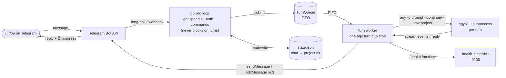

# 🚀 Telegrav

[](https://github.com/RosyidAl/Telegrav/actions/workflows/ci-cd.yml)
[](https://www.python.org/downloads/)
[](./tests)
[](./LICENSE)
[](https://systemd.io/)
[](https://antigravity.google)

Chat with the [Antigravity CLI](https://antigravity.google) (`agy`) from Telegram.

> **Fork notice.** This is a customized fork of [`hah23255/agy-to-im`](https://github.com/hah23255/agy-to-im) (which itself was bootstrapped from `kimi-to-im`), maintained by **Rosyid Al Ansorri** and deployed in production on an Azure VPS. The upstream project adapted the original bridge to drive Google's `agy` CLI; **this fork goes further** — see [Customizations in this fork](#customizations-in-this-fork). Each Telegram chat gets its own `agy` project/working directory so sessions persist across messages while staying isolated from one another.

**Self-hosted · single-user · Python · systemd-supervised · webhook-ready**

---

## English

### What it is
Telegrav is a Telegram bridge daemon for the Google Antigravity CLI (`agy`), allowing persistent, isolated code editing sessions over Telegram chats. Version: `0.2.0`.

### Customizations in this fork
The biggest change is architectural: **turn execution was moved out of the polling loop into a dedicated worker task**, so the daemon keeps fetching Telegram updates while `agy` works. Before, a long turn (up to 15 min) made the bot look dead; now new messages — including `/stop` — are seen instantly and acknowledged with live queue feedback.

| Customization | What it does |
|---|---|
| 🔀 Non-blocking daemon core | Polling loop + single turn worker (FIFO). New messages get `⏳ Queued (position #N)` feedback immediately; turns run strictly one at a time per worker. |
| 📡 Live turn monitor | The placeholder message is edited in place (throttled) with a step-by-step view of the agent's tool activity, then finalized as a summary checklist. |
| ⏻ Per-chat power toggle | `/on` / `/off`; the bot also never auto-replies to offline message dumps after a restart — it wakes only on `/start`. |
| 🧠 OKF memory layer | Optional graphify-based memory vault (`extract` → `export okf`) compiled per chat directory in the background. |
| ⌨️ More commands | `/ping`, `/model`, `/mode`, `/effort`, `/cd`, `/pwd`, `/getfile`, `/mcp`, `/skills`, `/stop` in addition to the upstream set. |
| 🧩 Model catalog | Aligned with the active `agy` models, including Gemini 3.8 effort-suffix handling (`-low/-medium/-high`). |
| 🖋️ Message formatting | Markdown → Telegram HTML with automatic plain-text fallback on parse errors. |
| 📎 Media pipeline hardening | Album/burst grouping, working media debounce (0.3 s follow-up fetch), instant placeholder **before** downloads, and stray-placeholder cleanup. |
| 🚦 Queue feedback & depth guard | Configurable queue depth from `config.json`, position feedback, per-user sliding-window rate limit. |
| 🏗️ CI/CD | GitHub Actions test matrix (Python 3.11/3.12) with automatic deployment to an Azure VPS via SSH on push to `main`. |
| ⚙️ systemd autostart opt-in | `install.sh --autostart` instead of always registering the service. |

### Features
| Feature | Status |
|---|---|
| Telegram ↔ `agy` messaging | ✅ |
| Non-blocking polling loop + dedicated turn worker | ✅ |
| Per-chat project isolation (`--new-project` / `--continue`) | ✅ |
| Inline keyboard control panel (`/settings`, `/model`, `/mode`) | ✅ |
| Live turn monitor with tool-activity progress | ✅ |
| Photo + document upload support with configurable safety routing | ✅ |
| Configurable file type allowlist (pass/warn/hold/block per category) | ✅ |
| Per-user rate limiting with sliding window | ✅ |
| Memory health gate with automatic self-restart | ✅ |
| Zombie subprocess reaping + garbage collection | ✅ |
| Multi-user FIFO turn queue with position feedback | ✅ |
| Per-chat token usage tracking (`/usage`) | ✅ |
| Webhook mode with HMAC verification | ✅ |
| Health endpoint (`/health`) and Prometheus metrics (`/metrics`) | ✅ |
| `systemd --user` service with hardening | ✅ |
| Plugin tool for `agy` (`bridge start/stop/status/logs/setup`) | ✅ |
| 221 tests (green on Linux CI) | ✅ |

### Quickstart

You need: Linux with `systemd --user`, Python ≥3.11, `uv`, a working `agy` CLI on `PATH`, and an authenticated `agy` session.

1. **Get a Telegram bot token** from [@BotFather](https://t.me/BotFather).
2. **Get your Telegram user ID** from [@userinfobot](https://t.me/userinfobot).
3. **Authenticate `agy` once** in a terminal:
   ```bash
   agy
   # complete the browser OAuth flow
   ```
4. **Install the bridge.**
   ```bash
   git clone https://github.com/RosyidAl/Telegrav.git \
     ~/.gemini/extensions/antigravity-telegram-bridge
   cd ~/.gemini/extensions/antigravity-telegram-bridge
   ./install.sh            # add --autostart to register the systemd service
   cp config.example.json config.json
   chmod 600 config.json
   $EDITOR config.json   # fill bot_token + allowed_user_ids
   systemctl --user start antigravity-telegram-bridge.service
   ```

For the full step-by-step guide see `docs/deployment.md`. Day-to-day operations are in `docs/OPERATIONS.md`.

### Configuration
```json
{
  "telegram": {
    "bot_token": "1234567890:...",
    "allowed_user_ids": [123456789],
    "allowed_chat_ids": []
  },
  "agy": {
    "chats_root": "",
    "default_workdir": "",
    "model": "",
    "mode": "code"
  }
}
```

### Text Commands
* `/start` - Welcome message
* `/ping` - Quick latency and health check
* `/help` - Usage help
* `/status` / `/info` - Session summary
* `/settings` - Inline control panel (model, mode, reset)
* `/model` - Select or view model override
* `/mode` - Switch between Code and Plan mode
* `/effort` - Set reasoning effort (low/medium/high/max)
* `/cd` - Change working directory for this chat
* `/pwd` - Show current working directory
* `/on` / `/off` - Activate / deactivate the bot for this chat
* `/stop` - Abort the active `agy` turn
* `/reset` - Start a fresh `agy` project for this chat
* `/files` - List inbox files (`/files clean` purges them)
* `/image on|off` - Toggle photo processing
* `/getfile` - Download a file from the workspace
* `/mcp` - View and manage MCP servers and tools
* `/skills` - List and inspect available skills
* `/queue` - Queue status
* `/usage` - Token usage for this chat (last turn / today / total)

### Architecture Mapping


### Fault Handling Manual
| Status / Error | Root Cause | Mitigation |
| :--- | :--- | :--- |
| `ModuleNotFoundError: No module named 'httpx'` | The daemon was started using the global python binary instead of the local virtual environment `.venv`. | Ensure the systemd unit or script runs within the project's virtual environment (`.venv/bin/python`). |
| Unauthorized / Token Rejected | The Telegram Bot API token is incorrect, expired, or blocked. | Check that `config.json` contains a valid bot token from BotFather. |
| Access Denied (User ID Whitelist) | The Telegram user ID sending messages is not in the whitelisted `allowed_user_ids` config array. | Add your user ID obtained from userinfobot to `config.json` and restart the daemon. |
| `systemd --user` service fails | The systemd user daemon cannot start the service (commonly due to missing user lingering). | Run `loginctl enable-linger` as root/user to allow user session daemons to run when logged out. |
| Webhook verification fails | The incoming webhook payloads are rejected due to mismatched HMAC signatures. | Check that the webhook endpoint config matches the active bot token, and no proxy is rewriting payload bodies. |
| Chat directory traversal error | A request attempted to read/write paths outside of the whitelisted `chats_root`. | Clean state database `state.json` and ensure no inputs bypass path validation hooks in `src/state.py`. |

### Common Issues & Golden Rules
* **Golden Rule 1: Default-Deny Access Control.** Always whitelists allowed user/chat IDs. Never run public-facing bridges without a strict filter list to prevent code execution by unauthorized users.
* **Golden Rule 2: Virtual Environment Isolation.** Always execute the daemon and tools inside `.venv/` to prevent package version conflicts and runtime import issues.
* **Golden Rule 3: Webhook HMAC Protection.** Under webhook deployment, always enforce HMAC-SHA256 signature verification on incoming requests to prevent mock payload injection.
* **Golden Rule 4: Systemd User session lingering.** Always verify that `loginctl enable-linger` is active for the target user, guaranteeing the bridge daemon persists across terminal logouts.
